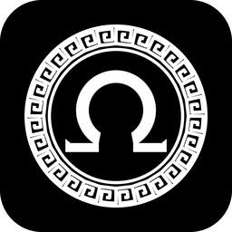

<div align="center">



# Ascension

**God of War: Ascension (PS3), an experiment in recompiling it to run natively on a PC.**

[](docs/STATUS.md)
[](#where-it-is)
[](#building-from-source)
[](#building-from-source)
[](LICENSE)

**English** · [Português (Brasil)](README.pt-BR.md)

</div>

---

Ascension is a static recompilation experiment: the game's PowerPC (PPU) and SPU code is translated ahead of time into C++ and compiled for your machine, on top of [ps3recomp](https://github.com/sp00nznet/ps3recomp)'s runtime and system libraries. It is a sibling of [Sparta](https://github.com/arnaldolima1/gow-ghost-of-sparta-pc) and [Olympus](https://github.com/arnaldolima1/gow-chains-of-olympus-pc), which do the same for the PSP games on PortableKit.

> [!WARNING]
> **An experiment, for curiosity: not playable.** The game boots and reaches its first menus, and that is all. The PS3 is far harder than the PSP: the game leans on six SPUs (SPURS jobs, Edge geometry, post-processing), and no ps3recomp port draws its 3D world yet. Windows and macOS (Apple Silicon); no Android.

> [!IMPORTANT]
> **No game data is included.** You need your own copy of the game: the **European release, `BCES-01741`** (1.00), as a disc image of your own disc. Nobody here can give you a copy, keys, or tell you where to get them. Ascension is not affiliated with Sony Interactive Entertainment or Santa Monica Studio.

## Where it is

**There is no release yet**: to try it, build it from source (below). As of October 2026, on Windows:

- **It boots and plays the intro screens**: the legal text, "Sony Computer Entertainment presents", the Santa Monica Studio logo and the online-play notice.
- **It loads and reaches the first menus**: the language prompt, the screen-adjust and brightness screens, drawn by the game's own shaders in its bronze font. On first use it writes its system save.
- **It plays the opening cinematic**, with picture and sound (MPEG-2 decoded by FFmpeg at run time). The main menu after it has not been seen yet, and the controller has not been tested.
- **It is slow**: about 10 fps through loading and the first-use menus, 33-38 fps in the cinematic; a panel in the top-right corner shows FPS, frame time, speed, CPU and GPU.

Getting this far took twenty-two commits of fixes to ps3recomp's runtime and renderer, all on [a fork](https://github.com/arnaldolima1/ps3recomp/tree/ascension-v0.15) and kept here as `patches/`: the second-generation SPURS (32 workloads, tasksets created from SPUs), GPU/SPU synchronization (the frame's SPU post-process, GCM semaphores and FIFO parks), the renderer (the font texture, sRGB output, shader derivatives), and a lifter bug that corrupted a heap. The full story, with what comes next, is in [docs/STATUS.md](docs/STATUS.md).

## Building from source

The layout this repository expects, with ps3recomp checked out beside it:

```
ascension-recomp/
  ps3recomp/    https://github.com/arnaldolima1/ps3recomp, branch ascension-v0.15
                (or https://github.com/sp00nznet/ps3recomp v0.15.0 with patches/ applied)
  ascension/    this repository
  work/         your disc and EBOOT, and what is made from them (never committed)
```

1. **The executable.** Take `PS3_GAME/USRDIR/EBOOT.BIN` from your disc image and decrypt it to `EBOOT.ELF`, either with RPCS3 (*Utilities › Decrypt PS3 Binaries*, with the console's firmware installed) or with `python tools/decrypt_self.py EBOOT.BIN -o EBOOT.ELF --keys <your scetool key file>`. Its key revision is `0x001C`.
2. **Analysis and lifting** with ps3recomp's pipeline (`elf_parser.py`, `find_functions.py`, `extract_spu_images.py`, `ppu_loader.py`, `ppu_lifter.py`): the steps are in ps3recomp's [Getting Started](https://github.com/sp00nznet/ps3recomp/blob/master/docs/GETTING_STARTED.md), and the lift command this game uses is in [docs/STATUS.md](docs/STATUS.md#the-pipeline). Use the v0.15 lifter: an older one corrupts the game's heap.
3. **Build** with CMake and Ninja: on Windows with Visual Studio 2022 (clang-cl); on macOS with Apple clang (the Xcode command-line tools) and `brew install cmake ninja sdl2 glslang spirv-cross ffmpeg`, configured with `-DPS3RECOMP_FFMPEG_RUNTIME=ON` so `cellVdec` can decode the opening cinematic (MPEG-2). The Python tools need 3.10 or newer. The generated code is large: a build from scratch takes 20-40 minutes and wants 16 GB of memory.
4. **Run.** Extract your disc to `work/disc` (so that `work/disc/PS3_GAME/USRDIR` exists) and put `EBOOT.ELF` next to `EBOOT.BIN` there. On Windows, from this directory: `build\win\AscensionRecomp.exe ..\work\disc\PS3_GAME\USRDIR\EBOOT.ELF`. On macOS, `tools/run_mac.sh` mounts the disc image at `work/disc` and runs the game in a window (`ASCENSION_ISO=<path to the .iso>` the first time). Saves go to `gamedata/dev_hdd0`.

## Credits

- [ps3recomp](https://github.com/sp00nznet/ps3recomp) by sp00nznet and contributors: the recompiler, runtime and system libraries.
- `tools/decrypt_self.py` comes from [Twisted Metal](https://github.com/sp00nznet/twistedmetal)'s port (MIT), adapted to read newer scetool key files.
- God of War is a trademark of Sony Interactive Entertainment. This is an unofficial project.

## License

MIT: see [LICENSE](LICENSE). It covers this repository's code only, not the game.
