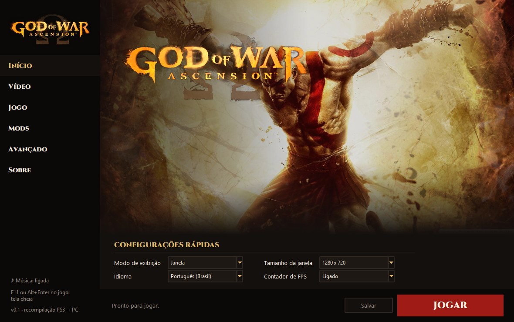
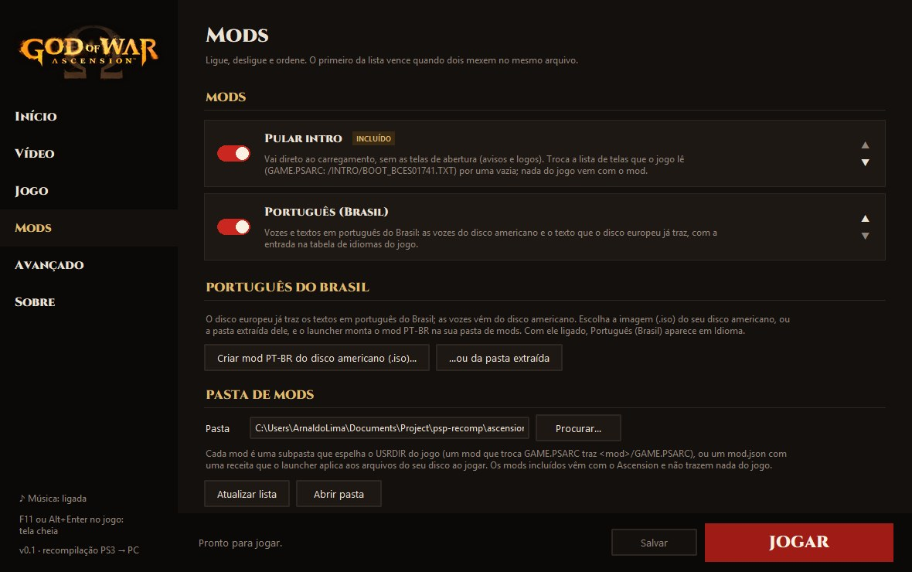

<div align="center">


# Ascension

**God of War: Ascension (PS3), recompiled to run natively on a PC.**

[](STATUS.md)
[](#where-it-is)
[](#building)
[](../LICENSE)

[Português (Brasil)](../README.md) · **English**

</div>

---

Ascension translates the game's code, for the PS3's main processor (PPU) and its SPUs, into C++ and compiles it for your PC, on top of the [ps3recomp](https://github.com/sp00nznet/ps3recomp) runtime. It is not an emulator: it is the game itself, recompiled. A sibling of [Sparta](https://github.com/arnaldolima1/gow-ghost-of-sparta-pc) and [Olympus](https://github.com/arnaldolima1/gow-chains-of-olympus-pc), which do the same for the PSP God of War games.

> [!WARNING]
> **An experiment: not playable from start to finish yet.** The game boots, goes through its menus and plays the opening cinematic; the main menu shows, but slowly. Windows only for now (macOS support is paused).

> [!IMPORTANT]
> **No game data is included.** You need your own copy, the **European release `BCES-01741`** (1.00), taken from your disc. Nobody here can give you the game or keys. A fan project, not affiliated with Sony Interactive Entertainment or Santa Monica Studio.

## Where it is

As of October 2026, on Windows:

- **Intro and menus:** the intro screens, the loading screen and the first-use menus (language, screen adjustment, brightness), drawn by the game's own shaders, answering the controller and the keyboard.
- **The opening cinematic** with picture and sound in sync, at the right speed (30 fps).
- **The main menu:** it draws its scene at about 12 fps (it was 1); the picture still has faults. Next.
- **A launcher** with video, language, subtitle and mod settings; the game runs inside its window.
- **Brazilian Portuguese**, voices and text, built from your own US disc.

No release yet. The detailed progress is in [STATUS.md](STATUS.md), the milestones in [MILESTONES.md](MILESTONES.md).

## Playing

With the game built (below), open the launcher:

```powershell
.\scripts\windows\launcher.ps1
```

<p align="center"></p>

PLAY starts the game inside the launcher's own window.

- **Video:** window or full screen (F11 or Alt+Enter also toggle in game), window size, FPS counter.
- **Game:** language (English, Portuguese, Spanish, French, German, Italian, Russian, Polish, Turkish) and subtitles, which hold after the first start too; confirm button; automatic save backups.
- **Mods:** turn them on and off, and order them. **Skip intro** comes with it (straight to the loading screen, no intro screens); **Create PT-BR mod** builds Brazilian Portuguese from your US disc image. The included mods are recipes the launcher applies to your own disc's files; none carries anything from the game.

<p align="center"></p>

Keyboard: arrows (d-pad), Z/X/A/S (cross, circle, square, triangle), Q/W (L1/R1), 1/2 (L2/R2), Enter (START), Tab (SELECT). A connected controller takes precedence.

## Building

```
ascension-recomp/
  ps3recomp/    https://github.com/arnaldolima1/ps3recomp, branch ascension-v0.15
  ascension/    this repository
  work/         your disc and what is made from it (never committed)
```

1. **Disc:** extract your image into `work/disc` and decrypt `PS3_GAME/USRDIR/EBOOT.BIN` to `EBOOT.ELF` (with RPCS3, or `tools/decrypt_self.py` and your keys file).
2. **Translation:** generate the code with ps3recomp's pipeline. The exact commands are in [STATUS.md](STATUS.md#how-it-is-built).
3. **Build:** CMake and Ninja; on Windows with Visual Studio 2022 (clang-cl) and `.\scripts\windows\build.ps1`. A build from scratch takes 20 to 40 minutes and needs 16 GB of memory.

Saves are kept in `gamedata/dev_hdd0`.

## Credits

- [ps3recomp](https://github.com/sp00nznet/ps3recomp), by sp00nznet and contributors: the recompiler, the runtime and the system libraries.
- `tools/decrypt_self.py`, from the [Twisted Metal](https://github.com/sp00nznet/twistedmetal) port (MIT).
- The launcher follows the style of [gow3_pc](https://github.com/FelipePrado0/gow3_pc)'s; Cinzel typeface (SIL Open Font License).
- God of War is a registered trademark of Sony Interactive Entertainment.

## License

MIT: see [LICENSE](../LICENSE). It covers this repository's code only, not the game.
